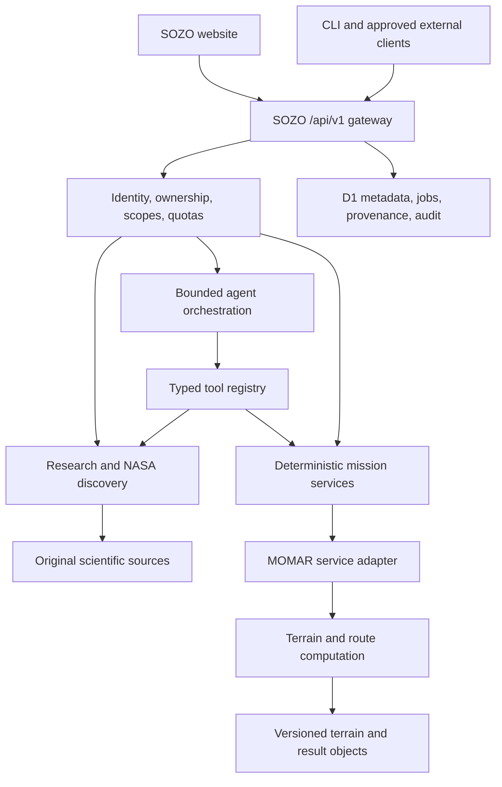

# SOZO + MOMAR: rebuild the backend around one API

**Status:** implementation plan, not a claim that the proposed services are connected.  
**Baseline:** SOZO v0.3, 27 October 2026.  
**Public application:** https://sozo-research-lab.sharpscarf8.chatgpt.site/  
**API entry point:** `https://sozo-research-lab.sharpscarf8.chatgpt.site/api/v1`

## 1. The outcome

Give the website, CLI, research agent, and approved external applications one authenticated API for scientific discovery and planetary mission planning. That API should find source records, read terrain metadata, request deterministic calculations from MOMAR, and return results with provenance, uncertainty, and limits.

“One API” means one contract, identity system, and entry point. The services behind it can run in different environments. A language model should call the same reviewed operations as a human-facing application; it should not implement terrain physics, invent routes, or receive database credentials.

The goal of helping astronauts explore, build, and work is a product direction. Operational mission decisions require validated models, suitable observations, and expert review. No autonomous control of mission hardware is part of this plan.

## 2. What exists today

| Capability            | Current implementation                                                           | Boundary                                                                     |
| --------------------- | -------------------------------------------------------------------------------- | ---------------------------------------------------------------------------- |
| Identity              | Server-side workspace login, eight-hour opaque sessions, optional Sites identity | Browser sessions are HttpOnly; credentials remain server-side                |
| External API access   | Hashed, revocable `sozo_` bearer keys                                            | Current keys inherit the owner's access; granular scopes are not implemented |
| Scientific discovery  | Crossref and Europe PMC retrieval, saved runs and source exports                 | Publication metadata and supplied abstracts, with optional cited Sarvam synthesis              |
| Space records         | Authenticated NASA Image and Video Library search                                | Original historical archive media and captions; not live telemetry           |
| Research organization | Projects, notes, sources, descriptive statistics, audit events                   | Owner-filtered D1 records                                                    |
| Tools                 | Versioned API, OpenAPI specification, CLI, bounded public-GET connector registry | Arbitrary private services and arbitrary code execution are not supported    |
| Planetary context     | Moon/Mars image globes and project-reported MOMAR inventory                      | Visualization and catalog; native terrain grids are not ingested into SOZO   |
| MOMAR planning        | Links to the external Moon and Mars prototypes                                   | No supplied routing API or accessible backend repository                     |
| Mission agent         | Grounded Sarvam companion and source-discovery workflow                                  | Sarvam conversation, voice and explicit screenshot vision are configured; the MOMAR routing adapter still needs its API               |

Keep existing working endpoints compatible during the rebuild. Preserve each owner's current research and credentials; do not replace D1 or reset records just to change the UI or introduce a gateway.

## 3. Target architecture



Use the existing Worker for the gateway, authentication, validation, small metadata operations, and response streaming. Large DEM processing belongs in a separate compute service or suitable job runtime. The current Worker has a constrained memory budget; loading millions of terrain cells into a request handler is not a sound architecture.

D1 remains the metadata store. Introduce object storage for raster tiles, route artifacts, and reports when needed. R2 is currently unconfigured in this project; adding it is a separate implementation step. Introduce a durable queue or workflow for long computations before promising crash recovery.

## 4. Split the existing code by responsibility

The current `lib/server-api.ts` dispatches many resources. Refactor incrementally into small handlers while preserving `/api/v1` URLs:

```text
lib/
  api/
    router.ts                 # route matching and common response envelope
    errors.ts                 # typed errors, request identifiers, safe messages
    middleware/
      identity.ts             # reuse existing server identity resolution
      ownership.ts
      scopes.ts               # new
      quotas.ts               # new atomic limits
    handlers/
      research.ts
      projects.ts
      notes.ts
      space-data.ts
      terrain.ts              # proposed
      routes.ts               # proposed
      agent-runs.ts           # proposed
  services/
    research-service.ts
    dataset-catalog.ts
    route-service.ts          # calls a validated compute adapter
    agent-service.ts          # bounded orchestration
  adapters/
    crossref.ts
    europe-pmc.ts
    nasa-archive.ts
    momar.ts                  # implement after the real contract is supplied
    model-provider.ts         # server-side provider configuration
  repositories/
    jobs.ts
    datasets.ts
    provenance.ts
    research.ts
```

Avoid a second authentication implementation inside MOMAR adapters or agent tools. Resolve identity once and pass a typed principal through the service layer. Keep provider credentials in server runtime secrets.

## 5. A consistent API contract

Use a common envelope for new endpoints. Migrate existing response shapes only with a documented compatibility policy:

```json
{
  "request_id": "opaque-request-id",
  "data": {},
  "provenance": [],
  "warnings": [],
  "generated_at": "ISO-8601 UTC timestamp"
}
```

Errors should include a stable code, safe explanation, retryability, and the request ID. Distinguish validation errors, unauthenticated access, forbidden scopes, missing datasets, unavailable providers, timeouts, and failed calculations. A failed upstream request must never turn into fabricated data.

Keep `/api/auth/login`, `/api/auth/session`, `/api/auth/logout`, and `/api/auth/token` as the current authentication boundary. Existing `/api/v1` routes continue to work. Add the proposed routes below only after implementation and tests; do not advertise unimplemented endpoints in the production OpenAPI specification.

| Operation                         | Status / purpose                                                   |
| --------------------------------- | ------------------------------------------------------------------ |
| `GET /api/v1/workspace`           | Existing owner workspace                                           |
| `POST /api/v1/research`           | Existing bounded scientific discovery                              |
| `GET /api/v1/space-data`          | Existing NASA archive search                                       |
| `GET /api/v1/datasets`            | Proposed unified catalog, product versions, footprints, and status |
| `GET /api/v1/terrain/sample`      | Proposed terrain lookup with uncertainty and native resolution     |
| `POST /api/v1/routes`             | Proposed deterministic route job                                   |
| `POST /api/v1/illumination`       | Proposed terrain/ephemeris calculation                             |
| `POST /api/v1/agent/runs`         | Proposed mission research and tool orchestration                   |
| `GET /api/v1/jobs/{id}`           | Proposed shared job status                                         |
| `GET /api/v1/jobs/{id}/events`    | Proposed authenticated progress events                             |
| `POST /api/v1/jobs/{id}/cancel`   | Proposed cancellation                                              |
| `GET /api/v1/jobs/{id}/artifacts` | Proposed report and GeoJSON references                             |

Publish one OpenAPI contract and generate clients from it. Add operation IDs, JSON schemas, examples, units, scopes, error codes, and limits. The website and CLI should use those clients instead of maintaining independent request definitions.

## 6. Make MOMAR an adapter behind this API

Before implementation, obtain the real backend repository or API documentation, its authentication method, dataset versions, licensing constraints, deployment model, and compute limits. The public website is not an API contract. Its linked repository returned 404 when checked in this build.

Expose a narrow internal interface such as:

```typescript
interface MomarAdapter {
  capabilities(): Promise<CapabilityManifest>;
  datasets(body: "moon" | "mars"): Promise<DatasetManifest[]>;
  sampleTerrain(input: TerrainSampleRequest): Promise<TerrainSampleResult>;
  planRoute(input: RouteRequest): Promise<RouteResult>;
  illumination(input: IlluminationRequest): Promise<IlluminationResult>;
}
```

The names above are proposed types, not existing imports. Each result must identify its original service, dataset/version, retrieval or computation time, and quality flags. If MOMAR is unavailable, return an explicit dependency failure or a partial research result. Never silently substitute the display globe for a DEM.

SOZO calls this adapter from the server. The browser receives safe results and job IDs; it never receives MOMAR service credentials. If a mission plan is private, any transferred coordinates and constraints must stay within the approved service boundary.

## 7. Preserve scientific meaning

Each dataset version needs at least:

- Provider, instrument, original product ID, URL, license, version/hash, and retrieval time.
- Body, coordinate frame, longitude convention, units, vertical datum, and projection definition. Preserve a WKT/PROJ definition when relevant; do not invent a lunar or Martian EPSG identifier.
- Actual observation footprint, missing-data mask, grid spacing, effective resolution, uncertainty, and quality flags.
- Whether the product is observed, modelled, derived, streamed, archived, or only catalogued.
- Derivation code/version, parent products, parameters, and computation timestamp for derived outputs.

The currently supplied figures remain **project-reported**: lunar 240 m primary grid, Martian 20 m grids, ≈5.96 million combined primary cells. Lunar 960 m far-field and 480 m Diviner overlap grids are excluded. The ≈133,000 km² lunar area describes a square polar-stereographic workspace with uneven observational coverage. Do not relabel these as independently verified SOZO ingestion totals.

Keep potential ice, thermal stability, and favourability separate from confirmed detections. Historical captions and planned missions retain their original dates and status. A current retrieval timestamp does not make an old mission description current.

## 8. Route computation is a deterministic service

A route request must specify the body, region, coordinate frame, start/stops/end, terrain product version, travel profile, constraints, and time when illumination matters. Bound the region, number of stops, native product access, runtime, and output size.

For each profile, make slope limits, roughness treatment, energy assumptions, shadow handling, data-quality penalties, communications requirements, and return-to-start behaviour explicit. Battery estimates must state the figures supplied by the user and the model used.

Return the geometry and measured or modelled values with units, plus rejected constraints, no-data crossings, uncertainty, and failure reasons. A shortest path and a lower-risk path should identify their actual objective functions and weights. Record the search algorithm and version. If no acceptable path exists, return `no_feasible_route`; do not draw a visually convenient line.

A missing DEM is a dependency failure. Do not generate a route using a texture, decorative mesh, interpolated fiction, or a language-model guess. Ephemeris checks and shadow validation need reproducible query parameters and a named reference dataset. The prototype's reported JPL comparison is not a SOZO validation result.

## 9. Add the agent after the tools work

Configure the chosen model through a server-side provider adapter. Require structured tool calls against the same schemas used by the API. Start with a small allowlist: scientific search, NASA archive search, dataset inspection, terrain sampling, route planning, illumination, and report generation.

Use a bounded run: maximum tool calls, provider cost budget, runtime, retries, artifact size, and explicit stop conditions. Treat webpages, publication text, tool responses, and imported metadata as untrusted evidence. They cannot change permissions or request secret disclosure.

A proposed request could look like:

```json
{
  "goal": "Compare terrain and illumination constraints for this lunar traverse",
  "body": "moon",
  "region_id": "an-actual-catalogue-region-id",
  "dataset_version_ids": ["actual-reviewed-product-version"],
  "allowed_tools": ["literature.search", "datasets.inspect", "routes.plan"],
  "constraints": { "travel_profile_id": "a-reviewed-profile-id" },
  "budget": { "maximum_tool_calls": 12 }
}
```

This example intentionally contains no fabricated coordinates or product IDs. The service validates real catalogue references before a run begins. The output should separate computed facts, retrieved source statements, assumptions, and model interpretation. Every quantitative statement must point to a calculation artifact or original source field.

## 10. Durable jobs, authentication, and storage

Replace `waitUntil`-only long jobs with persisted job records and durable dispatch. Preserve existing research run IDs and reports. A common lifecycle can be `queued → running → succeeded | partial | failed | cancelled`, with monotonic progress events, attempt counts, heartbeat, cancellation checks, and output references.

Use idempotency keys for job creation. Persist input hashes and dataset versions. Repeating the same key and payload should return the same job; conflicting payloads should fail explicitly. Workers must be safe to retry, and cancelled jobs must reject late writes.

Add scoped API keys such as `research:read`, `research:write`, `datasets:read`, `routes:compute`, and `agent:run`. Existing keys are owner-wide today; introduce scopes with a migration and explicit compatibility policy. Store only key/session hashes. Apply ownership checks to every job, event stream, artifact, note, and connector.

Suggested new metadata tables: dataset versions, observation footprints, capability manifests, jobs, job events, calculation artifacts, provenance edges, scoped keys, and quota buckets. Use append-only migrations and a tested rollback/recovery procedure. Do not run schema creation inside requests.

## 11. Build in this order

1. **Contract and gateway:** document current routes; introduce typed handlers and errors without changing behaviour. Verify existing auth, CLI, exports, and tenant isolation.
2. **Source and dataset layer:** normalize provenance, versions, units, footprints, and licensing; retain reported/unverified status until validation exists.
3. **MOMAR adapter:** implement against the actual service contract; start with capability discovery and one read-only terrain query. Add contract tests using reviewed fixtures and live smoke checks.
4. **Deterministic calculations:** expose route and illumination jobs with explicit profiles and reproducible artifacts. Validate small reference regions before increasing scale.
5. **Durable execution:** implement retries, idempotency, cancellation, object storage, and quotas; demonstrate crash recovery.
6. **Agent orchestration:** connect the selected model to the tested tool registry. Evaluate citation support, numerical agreement, dependency failures, and prompt-injection resistance.
7. **Client rollout:** migrate the dashboard and CLI to generated clients; publish a versioned SDK and migration guide.

## 12. Acceptance criteria

- A browser, CLI, and external application can perform the same approved workflow through one API and identity model.
- Missing authentication and cross-owner resource access are rejected, including events and artifacts.
- Provider outages remain visible; no synthetic evidence or terrain is substituted.
- A route can be replayed from its saved inputs, terrain versions, profile, algorithm version, and parameters.
- Numerical results match independent reference cases within documented tolerances. Benchmark claims include hardware, region, resolution, algorithm, and input/output artifacts.
- Large calculations run outside the gateway memory budget and survive a controlled worker interruption.
- Agent output distinguishes source facts, computed values, assumptions, uncertainty, and interpretation.
- Production OpenAPI includes only implemented operations. Planned endpoints remain in design documents until they are ready.

## 13. Immediate handoff checklist

When ready to connect MOMAR, supply its backend repository/API documentation and choose the AI provider. Configure secrets through server runtime settings. Then implement the adapter and deterministic service layer first, followed by agent orchestration. The redesigned UI, existing protected API, live NASA archive, and this plan can ship independently of those future connections.
